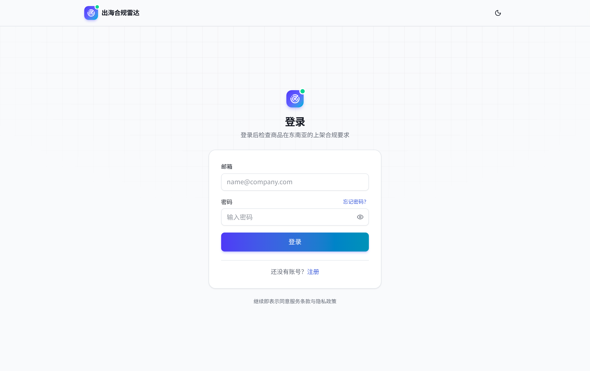
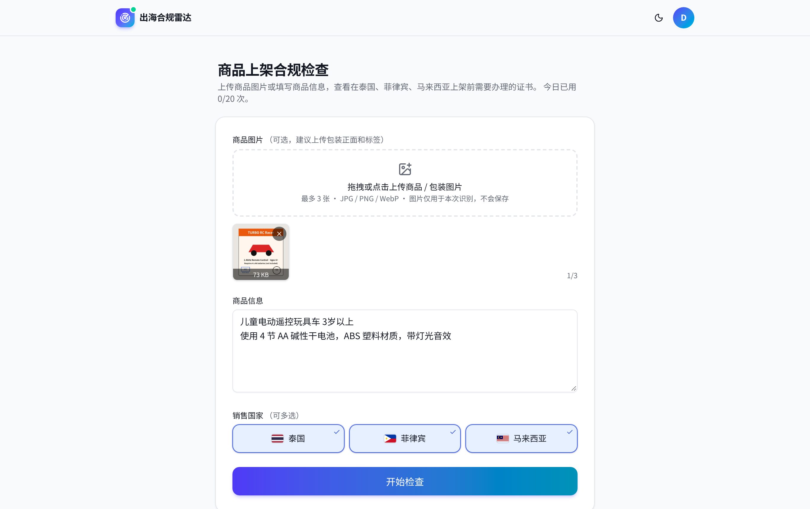
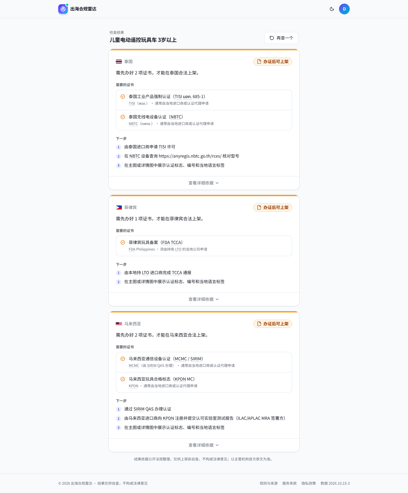
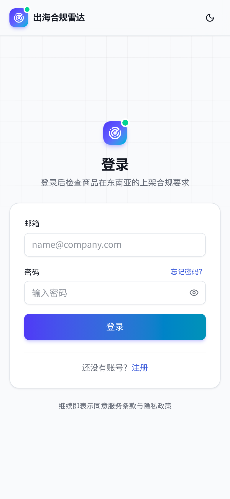
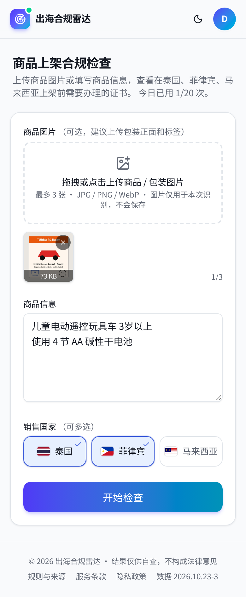
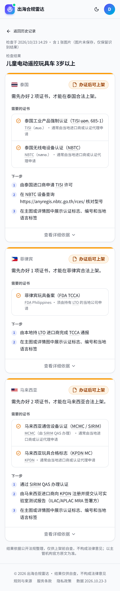
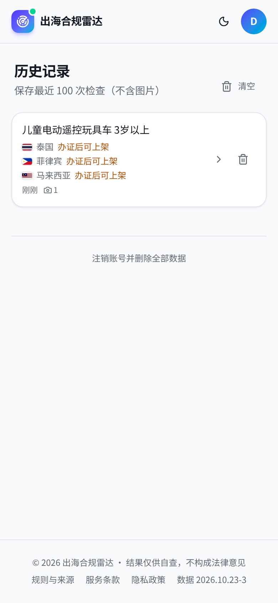

# 出海合规雷达 · 东南亚跨境电商上架前合规检查（TH / PH / MY）

| 登录 | 填写商品 | 检查结果 |
|---|---|---|
|  |  |  |

帮助中国跨境卖家在 **泰国、菲律宾、马来西亚** 上架之前，确认小家电、充电器/适配器/充电宝、玩具、化妆品四类商品能否销售、需要办哪些证。

**使用流程**

1. **登录 / 注册**：邮箱 → 发送验证码 → 输入 6 位验证码并设置密码 → 自动登录。忘记密码走同一套验证码流程。
2. **填写商品**：最多 3 张商品/包装图片（拖拽或点击，可移除）+ 一段“商品信息”，勾选要销售的国家（可多选），点“开始检查”。
3. **等待**：通常 15–20 秒（带图片、多国时稍长）。
4. **结果**：每个国家一张卡片，默认只显示
   - 结论：**可以上架** / **办证后可上架** / **不能销售**，加一句说明；
   - 需要的证书（名称 + 签发机构/办理渠道）；
   - 最多 3 条下一步。
   
   “查看详细依据”里是风险等级、识别依据、官方原文引用、可能需要的认证、平台与展示规则、待复核内容。
5. **之后**：“再查一个”清空表单；右上角头像菜单有“历史记录”（查看、删除、可撤销）和“退出登录”。

> ⚠️ **结果仅供自查，不构成法律意见。** 法规会变；每条结论都附知识库原文引用与来源链接，没有依据的内容一律标“待复核”。服务条款与隐私政策见 `/terms/`、`/privacy/`。

## 架构

```
GitHub Pages（静态 Next.js export）                 Cloudflare Worker（worker/）
  ├─ /            登录卡片 ⇄ 检查工作区                 POST /api/auth/send-code | register | reset | login
  ├─ /history/    历史记录                              GET  /api/auth/me    DELETE /api/auth/account
  ├─ kb/rules.json 打包进前端（66 条规则）               POST /api/check  { info, countries[], images[] }
  └─ 前端按国家合并规则匹配 + AI 结果并再校验引用 ◀──     ├─ 图片 → 视觉模型一次，提取结构化事实（所有国家共用）
                                                        ├─ 每个国家并行：确定性匹配 → LLM → 引用逐字校验 → guard
                                                        ├─ GET/DELETE /api/history[/:id]
                                                        └─ D1：users / checks / usage / email_codes / mail_counters
```

- 规则与确定性匹配优先；LLM 只负责品类判断、边缘特征（如无线/蓝牙）、补充规则和中文解释。
- LLM 给的引用在服务端和前端各校验一次，不是原文子串的引用会显示为“待复核”或直接丢弃。
- guard（`src/lib/core/guard.ts`）：LLM 建议的“无线”“充电器”特征要在商品信息/图片里找到明确依据才采纳；**商品只写碱性/干电池（AA/AAA 等）且未提锂电时，不触发 UN38.3 / UN3480 / 承运限制 / 泰国 TISI 电池等锂电规则**（确定性匹配 `match.ts` 与 guard 两处都做了限制）。
- 结论映射（`src/lib/core/verdict.ts`）：命中禁售 → 不能销售；有强制认证 → 办证后可上架；否则 → 可以上架；品类无法识别时显示“暂无法判断”，并提示补充信息。
- 平台（TikTok Shop / Shopee / Lazada）不再需要选择，相关平台规则只在“查看详细依据”中列出。
- 图片：最多 3 张 jpg/png/webp，浏览器端缩到 ~1024px、总计 ≤1.5MB；**图片不保存**。历史只存文字摘要 + 结果 JSON，可删除。Worker 日志只记 `{evt, code, ms}`，不记录输入、验证码或密钥。

## 账号与鉴权（worker/src/auth.ts、worker/src/mail.ts）

- **邮箱验证码**：6 位数字，D1 中只存 HMAC-SHA256 哈希（以 `JWT_SECRET` 为密钥，绑定邮箱与用途），10 分钟有效，最多错 5 次（原子计数，第 5 次后需重新获取），同一邮箱同一用途 60 秒内不能重发；每邮箱每天 `MAIL_PER_EMAIL_PER_DAY`（默认 8）封、每 IP 每天 `MAIL_PER_IP_PER_DAY`（默认 20）封（计数只存哈希）。注册与重置分别使用独立的验证码。
- **注册**：保留 honeypot 字段；密码 ≥8 位且含字母与数字；每 IP 每天注册数上限 `REG_PER_IP_PER_DAY`；`RL_AUTH` 每 IP 每分钟 6 次。已注册邮箱会直接提示“已注册，请直接登录”。
- **忘记密码**：对未注册邮箱同样返回成功（不发送邮件，不暴露邮箱是否注册）；重置成功后旧的登录凭证全部失效（JWT 中的 `v` 与 `users.token_ver` 比对）。
- **密码**：PBKDF2-SHA256（默认 100k 次迭代）+ 16 字节随机盐；JWT HS256，有效期 7 天，存 localStorage，以 `Authorization: Bearer` 发送。
- **邮件**：Brevo 事务邮件 API（`POST https://api.brevo.com/v3/smtp/email`，请求头 `api-key`），中文 HTML + 纯文本两个版本。
  - 线上：必须设置 secret `BREVO_API_KEY`，否则发送验证码返回 503 `mail_disabled`（“邮件服务暂未配置”），**验证码永远不会出现在线上响应里**。
  - 本地：未设置 `BREVO_API_KEY` 且 `DEV_MAIL_LOG=1` 时，验证码打印在 wrangler 控制台，并且仅当请求发往 localhost/127.0.0.1 时才在响应里返回 `dev_code`（页面显示“本地开发模式：验证码 …”）。
- 每用户每日检查次数 `DAILY_AI_QUOTA`（默认 20）+ 每 IP / 全局限流。一次检查（无论选几个国家）计 1 次。

## 截图

`docs/screenshots/`（`node scripts/screenshots.cjs` 用无头 Chrome 走真实流程生成）：

| 桌面 | |
|---|---|
| 登录 `desktop-login.png` | 注册（验证码步骤）`desktop-register-code.png` |
| 填写商品 `desktop-submit.png` | 检查中 `desktop-progress.png` |
| 结果 `desktop-result.png` | 展开详细依据 `desktop-result-details.png` |
| 头像菜单 `desktop-avatar-menu.png` | 历史记录 `desktop-history.png` |

| 手机 | | | |
|---|---|---|---|
|  |  |  |  |

## 知识库

- `kb/build_rules.py` → `kb/rules.json`（版本 `2026.10.23-3`，66 条规则）
- `kb/snapshots/`：抓取的来源原文快照 + `kb/snapshots.sha256`
- `npm run kb:verify`：逐条校验摘录是否是快照的逐字子串。当前 129 条摘录：123 条 verified、6 条 verified_ocr（扫描件 OCR）、6 条 paraphrase（明确标注为转述）。
- 详见 `kb/README.md`。

## 本地运行

需要 Node 22（wrangler 4）。

```bash
npm ci && (cd worker && npm ci)
npm run kb:verify && npm run test:core

# 1) Worker 密钥与本地变量（.dev.vars 已 gitignore，切勿提交）
cp worker/.dev.vars.example worker/.dev.vars && chmod 600 worker/.dev.vars
#    填入 ZHIPUAI_API_KEY、JWT_SECRET（openssl rand -base64 48）；保留 DEV_MAIL_LOG=1 即可不配邮件

# 2) 本地 D1 + 启动 Worker
cd worker
npx wrangler d1 migrations apply sea-precheck --local
npx wrangler dev --port 8787            # 验证码会打印在这个控制台
cd ..

# 3) 前端
NEXT_PUBLIC_API_URL=http://127.0.0.1:8787 npx next build && npm run serve   # http://127.0.0.1:3000/
```

本地注册时，页面会直接显示验证码（仅 localhost + `DEV_MAIL_LOG=1`）。想在本地真实发信，把 `BREVO_API_KEY=...` 写进 `worker/.dev.vars`（此时 `DEV_MAIL_LOG` 不再生效）。

**端到端脚本**（注册 → 错误验证码/冷却/锁定 → 登录 → 忘记密码 → 三国+图片检查 → 历史 → 删除 → 未登录拒绝）：

```bash
cd worker && npx wrangler dev --port 8787 --var RATE_LIMIT_DISABLED_LOCAL:1 &   # 脚本 1 分钟内调用十几次认证接口，需关闭本地限流
npm run test:e2e -- --api http://127.0.0.1:8787 --image /path/to/pack.jpg
```

不带 `RATE_LIMIT_DISABLED_LOCAL` 运行时，第 7 次认证请求会按设计返回 429。

`wrangler.toml` 变量：`LLM_BASE_URL`、`LLM_MODEL`（默认 `glm-5.3-flash`）、`LLM_THINKING`、`AGENT_IMPL`（`fetch` 默认 | `pi`）、`REQUEST_TIMEOUT_MS`、`ALLOWED_ORIGINS`、`RATE_LIMIT_PER_HOUR`、`VISION_BASE_URL` / `VISION_MODEL`、`DAILY_AI_QUOTA`、`REG_PER_IP_PER_DAY`、`PBKDF2_ITERATIONS`、`MAIL_FROM`（默认 `zhu05361@gmail.com`）、`MAIL_FROM_NAME`（默认 `出海合规雷达`）、`MAIL_PER_EMAIL_PER_DAY`、`MAIL_PER_IP_PER_DAY`。绑定：`DB`（D1）、`RL_IP` / `RL_GLOBAL` / `RL_AUTH`。密钥只用 `wrangler secret put`：`ZHIPUAI_API_KEY`、`JWT_SECRET`、`BREVO_API_KEY`。

## 评测

```bash
npm run eval:baseline                                    # 纯规则
npx tsx eval/run.ts --api http://127.0.0.1:8788 --label glm-5.3-flash-fetch --concurrency 2   # 自动用本地验证码注册/登录评测账号（Worker 需 DEV_MAIL_LOG=1 且无 BREVO_API_KEY）
npx tsx eval/run_images.ts --api http://127.0.0.1:8788 --label glm-5.3-flash                # 6 张图片样本
```

`eval/samples.json` 共 39 条（3 国 × 4 品类），结果写入 `eval/results/<label>.json`。指标：认证召回/精确率、完全匹配、品类准确率、幻觉引用率（未通过校验 + 因 rule_id 不存在被丢弃的 notes 占比）、待复核率、品牌命中、延迟、失败码。

最近结果（2026-10-23）：

| 文本 39 条 | 认证召回 | 精确率 | 完全匹配 | 品类 | 幻觉引用率 | 失败 | p50 / p90 |
|---|---|---|---|---|---|---|---|
| 纯规则 | 0.830 | 1.0 | 32/39 | 0.923 | — | — | — |
| glm-5.3-flash（fetch，v7） | 1.0 | 1.0 | 39/39 | 1.0 | 0.100 | 0 | 14.3 / 21.1 s |
| glm-5.3-flash（fetch，v9，邮箱验证码 + 多国版 Worker） | 1.0 | 1.0 | 39/39 | 0.974 | 0.082 | 0 | 16.4 / 20.5 s |

说明：v7 起金标准包含锂电池规则（UN38.3 / UN 3480 / 承运限制 / 泰国 TISI 电池），纯规则基线因此从 0.829 降为 0.811（标题未写“电池”但实际含电池的样本只能由 AI 判断）；AI 结果与 v3 持平。v9 起干电池（AA/AAA 碱性）玩具不再触发锂电池规则，延长线/插线板改为确定性识别，纯规则基线升至 0.830 / 32；v9 未经 guard 的原始 AI 输出为召回 1.0 / 精确 0.964 / 37，guard 校正后 39/39。评测样本均为单国请求；多国 + 图片流程由 `npm run test:e2e` 覆盖（3 国 + 1 张图约 30 s）。

图片 6 条（合成包装图，`eval/images/`，两种视觉模型同一套流程对比）：

| 指标 | glm-5.3-flash（默认） | glm-4.6v |
|---|---|---|
| 认证标志召回/精确 | 1.0 / 1.0 | 1.0 / 1.0 |
| 品牌 / 品类 | 6/6 / 6/6 | 6/6 / 6/6 |
| 标签语言完全一致 | 6/6 | 5/6 |
| 无线 / 电池严格一致（未断言计入后） | 4/6 / 4/6（6/6） | 3/6 / 3/6（6/6） |
| 认证召回/精确 | 1.0 / 1.0 | 1.0 / 1.0 |
| 吸尘器 Cordless 未误判为无线 | 是 | 是 |
| 视觉 p50 | 4.3 s | 3.9 s |
| 端到端 | 15–26 s | 16–26 s |

此前的适配器规则误报（无线充电宝）已通过“无线充”不再视为充电器关键词修复。**样本仅 6 张、且为合成图，结论不可外推。**

## 部署

见 [DEPLOY.md](DEPLOY.md)（GitHub Pages + Cloudflare Workers、D1、密钥、限流说明、CPU 10ms 限制、国内可达性）。
