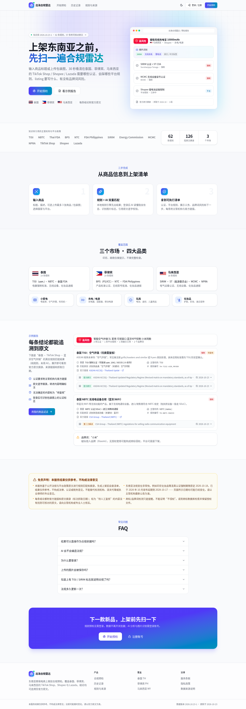
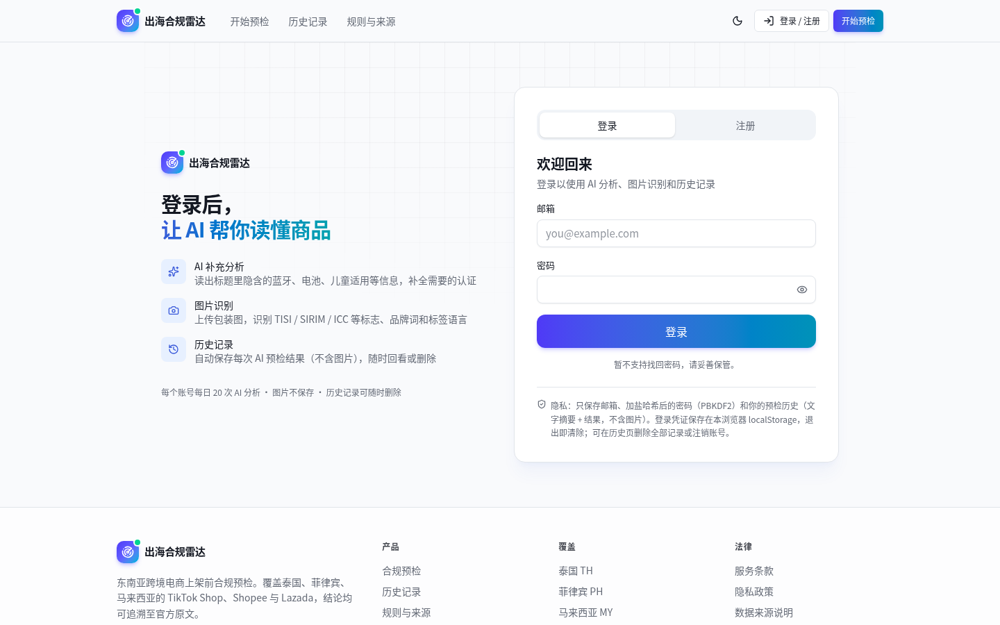
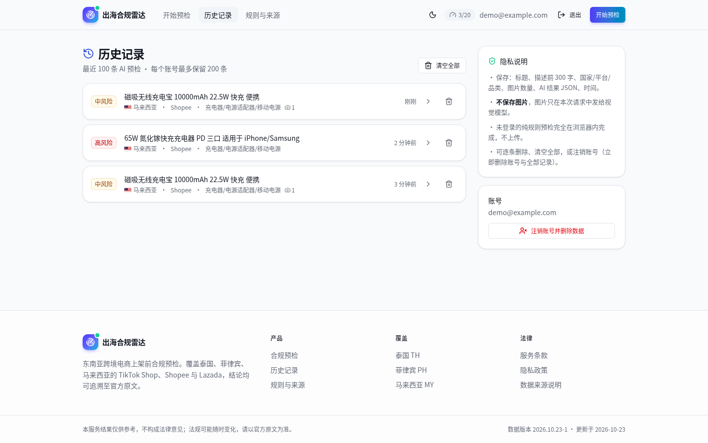
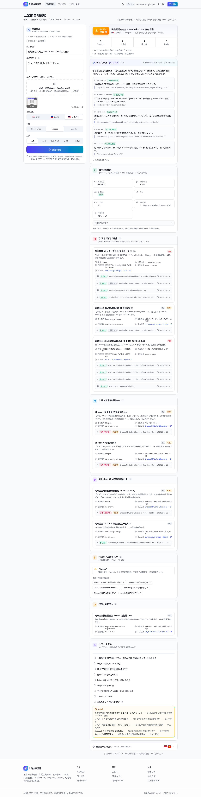
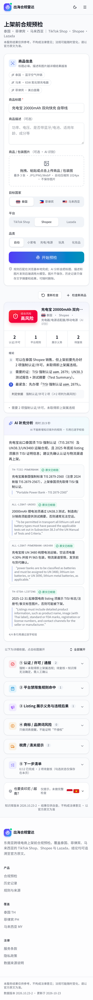

# 出海合规雷达 · 东南亚跨境电商上架前合规预检（TH / PH / MY）



帮助中国跨境卖家在 **TikTok Shop / Shopee / Lazada** 上架 **泰国、菲律宾、马来西亚** 之前，自查四类商品（小家电、充电器/适配器/充电宝、玩具、化妆品）的：

1. 认证 / 许可（TISI、FDA、NBTC、DTI PS/ICC、NTC、SIRIM/ST、MCMC、KPDN、NPRA…）
2. 平台禁售 / 限售命中
3. 商品页展示义务（泰国 ETDA 2025-12-31 生效；菲律宾 DTI DAO 25-02）
4. 商标 / 品牌词风险（附 TMview 与各国商标局查询链接；**从不声称"不侵权"**）
5. 风险等级与下一步

印尼（FOB US$100）、越南（低值进口 VAT）仅作为提示出现。

> ⚠️ **本服务结果仅供参考，不构成法律意见。** 法规会变（例：印尼清真认证截止日期从 2026-10-18 被推迟到 2028-10-17）。每条结论都附知识库原文引用与来源链接；没有依据的内容一律标"待复核"。服务条款与隐私政策见 `/terms/`、`/privacy/`。

## 架构

```
GitHub Pages（静态 Next.js export）               Cloudflare Worker（worker/）
  ├─ 知识库 kb/rules.json 打包进前端                  POST /api/check
  ├─ 确定性匹配：关键词/品类识别 + BM25 + 规则        ├─ pi-mono Agent（pi-agent-core + pi-ai）
  ├─ 品牌词库命中                                     │   工具：lookup_rules / get_rule / check_brand
  └─ 调用 NEXT_PUBLIC_API_URL（可选）──────────────▶  ├─ 智谱 OpenAI 兼容接口（LLM_BASE_URL / LLM_MODEL）
       失败/未配置 → 只显示规则结果                    ├─ 输出 JSON → 校验：rule_id 必须在候选集、quote 必须是原文逐字子串
                                                      └─ 每 IP 限流、CORS、输入上限、超时、额度用尽友好提示
```

- 规则与确定性匹配优先；LLM 只负责品类判断、边缘特征（如无线/蓝牙）、补充规则和中文解释。
- LLM 给的引用在服务端和前端各校验一次，不是原文子串的引用会显示为"待人工复核"或直接丢弃。
- LLM 建议的"无线"/"充电器"特征要在标题/描述里找到明确关键词才采纳（`src/lib/core/guard.ts`），避免把射频认证套到普通电器上、把适配器认证套到充电宝上。
- 规则预检完全在浏览器本地；AI 分析与图片识别需要登录。图片不保存；登录用户的历史只存文字摘要 + 结果 JSON，可删除。Worker 日志只记 `{evt, code, ms}`。
- 图片：最多 3 张 jpg/png/webp（拖拽/粘贴/选择），浏览器端缩到 ~1024px、总计 ≤1.5MB，base64 发送；Worker 先调视觉模型（`VISION_MODEL`，默认 `glm-4.6v`）提取结构化事实（认证标志、品牌、无线/电池、标签语言、品类），作为 `source:'image'` 证据进入同一套 guard 与引用校验。

## 账号与鉴权（worker/src/auth.ts）

- 邮箱 + 密码；PBKDF2-SHA256（WebCrypto，默认 100k 次迭代，workerd 上限）+ 16 字节随机盐；JWT HS256（`JWT_SECRET`），有效期 7 天。
- 注册防滥用：HMAC 签名的无状态算术题（10 分钟有效）、honeypot 字段、密码规则（≥8 位、含字母与数字）、每 IP 每天注册数上限（`REG_PER_IP_PER_DAY`，IP 只存 HMAC 哈希）、`RL_AUTH` 每 IP 每分钟 6 次。
- 每用户每日 AI 次数 `DAILY_AI_QUOTA`（默认 20）+ 原有每 IP / 全局限流。
- Token 存 localStorage，以 `Authorization: Bearer` 发送。取舍：前端在 GitHub Pages、API 在 workers.dev，跨站 cookie 需要 `SameSite=None; Secure` 且会被第三方 cookie 拦截影响；Bearer 不受 CSRF 影响，代价是 XSS 时 token 可被读取（站点无第三方脚本、React 默认转义以降低风险）。
- 已知局限：无邮箱验证、无找回密码；JWT 不能单独吊销（注销账号或轮换 `JWT_SECRET` 才能失效）；算术题在有效期内可重放（仅用于挡低级脚本）；每小时限流按 isolate 计；PBKDF2 在 Workers Free 计划 10ms CPU 下可能超限（见 DEPLOY.md）。

## 截图

| 首页 | 登录 | 历史 |
|---|---|---|
|  |  |  |

| 预检（图片 + 完整结果，桌面） | 预检结果（移动端） |
|---|---|
|  |  |

## 知识库

- `kb/build_rules.py` → `kb/rules.json`（版本 `2026.10.23-1`，62 条规则）
- `kb/snapshots/`：抓取的来源原文快照 + `kb/snapshots.sha256`
- `npm run kb:verify`：逐条校验摘录是否是快照的逐字子串。当前共 126 条摘录：115 条 verified、6 条 verified_ocr（扫描件 OCR）、5 条 paraphrase（明确标注为转述，主要是 Shopee/Lazada 帮助中心无法抓取的平台规则）。
- 详见 `kb/README.md`。

## 本地运行

```bash
npm ci
npm run kb:verify
NEXT_PUBLIC_API_URL=http://127.0.0.1:8787 npx next build   # 产物在 out/
npm run serve                                              # http://127.0.0.1:3000/

# Worker（wrangler 4 需要 Node 22）
cd worker && npm ci
printf 'ZHIPUAI_API_KEY=...\n' > .dev.vars && chmod 600 .dev.vars   # 已 gitignore，切勿提交
npx wrangler dev --port 8787
curl http://127.0.0.1:8787/api/health
```

本地 D1：`npx wrangler d1 migrations apply sea-precheck --local`；`.dev.vars` 另需 `JWT_SECRET=<随机 32 字节>`。

`wrangler.toml` 变量：`LLM_BASE_URL`（默认 Coding Plan `https://open.bigmodel.cn/api/coding/paas/v4`）、`LLM_MODEL`（默认 `glm-5.3-flash`）、`LLM_THINKING`（`off` | `low` | `high`，默认 off）、`AGENT_IMPL`（`fetch` 默认 | `pi`）、`REQUEST_TIMEOUT_MS`、`ALLOWED_ORIGINS`、`RATE_LIMIT_PER_HOUR`、`VISION_BASE_URL` / `VISION_MODEL`（默认 Coding 端点 + `glm-4.6v`）、`DAILY_AI_QUOTA`、`REG_PER_IP_PER_DAY`、`PBKDF2_ITERATIONS`。绑定：`DB`（D1）、`RL_IP` / `RL_GLOBAL` / `RL_AUTH`。密钥只用 `wrangler secret put ZHIPUAI_API_KEY` 与 `wrangler secret put JWT_SECRET`。

## 评测

```bash
npm run eval:baseline                                    # 纯规则
npx tsx eval/run.ts --api http://127.0.0.1:8788 --label glm-5.3-flash-fetch --concurrency 2   # 自动注册/登录评测账号
npx tsx eval/run_images.ts --api http://127.0.0.1:8788 --label glm-4.6v                     # 6 张图片样本
```

`eval/samples.json` 共 39 条（3 国 × 4 品类），结果写入 `eval/results/<label>.json`。指标：认证召回/精确率、完全匹配、品类准确率、幻觉引用率（未通过校验 + 因 rule_id 不存在被丢弃的 notes 占比）、待复核率、品牌命中、延迟、失败码。

最近结果（2026-10-23）：

| 文本 39 条 | 认证召回 | 精确率 | 完全匹配 | 品类 | 幻觉引用率 | 失败 | p50 / p90 |
|---|---|---|---|---|---|---|---|
| 纯规则 | 0.829 | 1.0 | 33/39 | — | — | — | — |
| glm-5.3-flash（fetch，v3） | 1.0 | 1.0 | 39/39 | 1.0 | 0.095 | 0 | 15.4 / 22.8 s |

图片 6 条（合成包装图，`eval/images/`，glm-4.6v）：认证标志识别召回/精确 1.0/1.0，品牌 6/6，品类 6/6，标签语言完全一致 5/6，认证召回 1.0 / 精确 0.875（1 个误报：无线充电宝多出 MY 适配器规则），吸尘器 "Cordless" 未被误判为无线；无线/电池严格一致各 3/6——其余 3 条模型均回答"不确定"(null) 而非错误断言，按"未断言"计为 6/6。视觉 p50 7.5 s，端到端 18–30 s。**样本仅 6 张、且为合成图，结论不可外推。**

## 部署

见 [DEPLOY.md](DEPLOY.md)（GitHub Pages + Cloudflare Workers、D1、密钥、限流说明、CPU 10ms 限制、国内可达性）。
